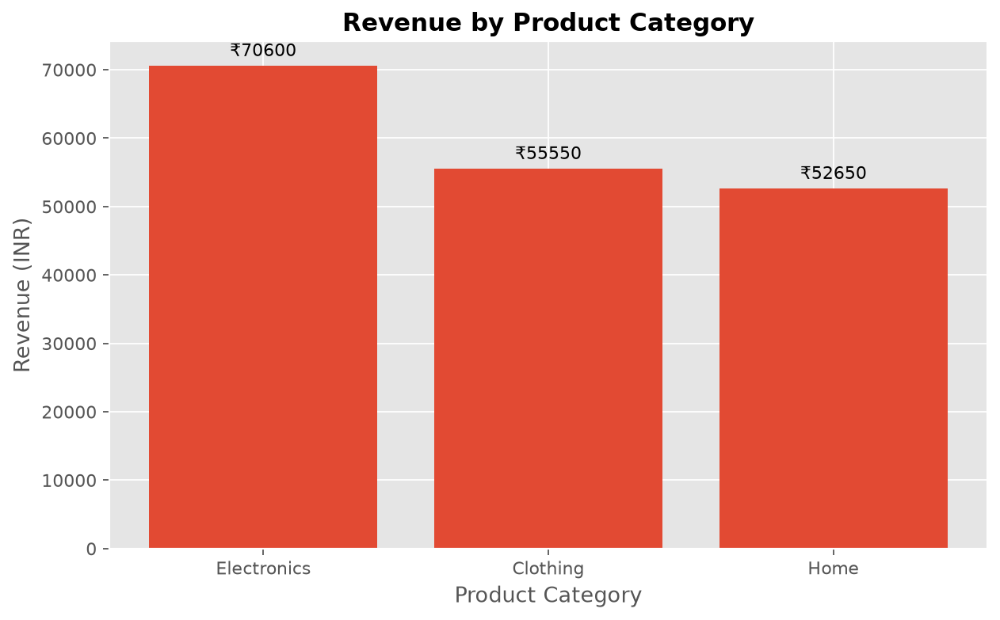
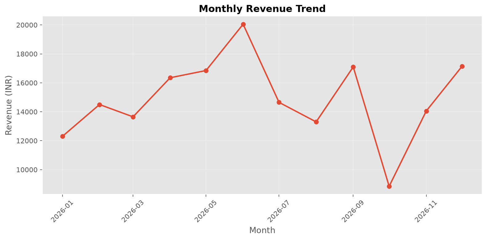
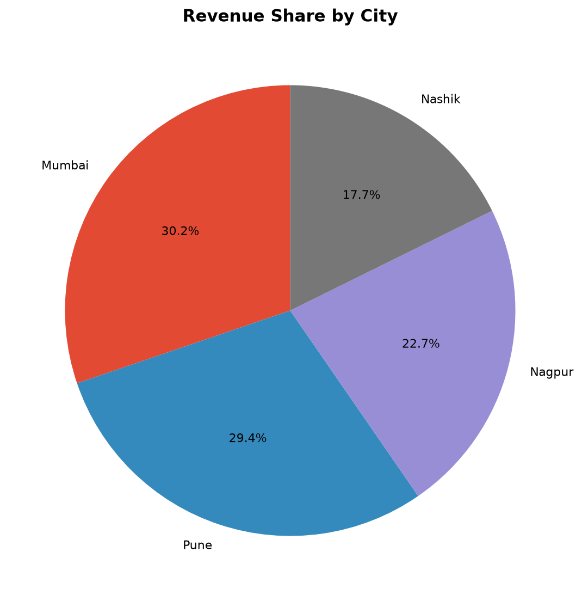

# E-commerce Sales Analysis Report

> **Dataset note:** This is a sample learning dataset, not real business data.

## 1. Executive Summary

- **Total revenue:** ₹178,800.00
- **Units sold:** 169
- **Valid order records:** 47
- **Average revenue per record:** ₹3,804.26
- **Top category:** Electronics (₹70,600.00)
- **Top city:** Mumbai (₹54,050.00)

## 2. Data Quality

- Rows loaded: 49
- Duplicate rows removed: 1
- Invalid/incomplete rows removed: 1
- Rows retained: 47

## 3. Key Findings

1. **Category performance:** Electronics generated the highest revenue at ₹70,600.00.
2. **Monthly trend:** June 2026 was the strongest month (₹20,050.00); October 2026 was the weakest (₹8,850.00).
3. **City performance:** Mumbai contributed the most revenue at ₹54,050.00, approximately 30.2% of total revenue.
4. **Business interpretation:** Revenue differences may reflect order volume, product mix, and discounts. More data would be needed before treating these patterns as long-term trends.

## 4. Visualizations

### Revenue by Product Category

### Monthly Revenue Trend

### Revenue Share by City

## 5. Revenue by Category

| Category | Revenue |
|---|---:|
| Electronics | ₹70,600.00 |
| Clothing | ₹55,550.00 |
| Home | ₹52,650.00 |

## 6. Recommendations

- Review the product mix and stock availability in the **Electronics** category to understand what is driving its performance.
- Investigate the causes of the revenue dip in **October 2026** before changing budgets or inventory.
- Compare marketing spend and order counts by city, especially in **Mumbai**, before reallocating campaigns.
- Continue collecting consistent data over multiple periods; avoid drawing conclusions from this sample alone.

## 7. Methodology

1. Loaded the CSV dataset with pandas.
2. Parsed dates and converted numeric columns.
3. Removed duplicate rows and records missing essential fields; excluded non-positive quantities.
4. Calculated revenue as `(quantity × unit_price) - discount`.
5. Aggregated revenue by category, month, and city.
6. Generated charts using Matplotlib and wrote this report.

## 8. Limitations

- The dataset is synthetic and intentionally small for practice.
- Discount is treated as a fixed amount per row, not a per-unit discount.
- No costs or returns are provided, so this report analyzes revenue rather than profit.
